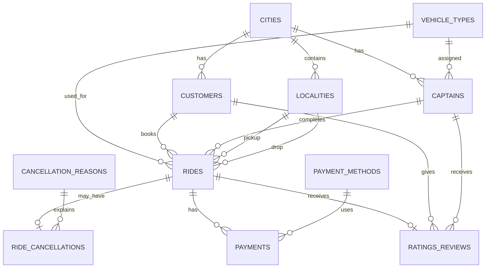

# Rapido-Inspired Ride Booking SQL Case Study

## Project Overview

This project analyzes a **synthetic / academic Rapido-inspired ride-hailing dataset** using MySQL. The goal is to practice SQL and generate business-oriented insights around rides, customers, captains, cities, revenue, payments, cancellations, and ratings.

> **Important:** This is not official Rapido company data. The database dump is explicitly marked as synthetic data.

## Tools Used

- MySQL 8.0+
- MySQL Workbench
- SQL
- GitHub

## Database Overview

| Area | Details |
|---|---|
| Database | `rapido_db` |
| Cities | 12 |
| Vehicle types | 3 |
| Localities | 193 |
| Customers | 16,980 |
| Captains | 3,001 |
| Rides | 50,000 |
| Ride cancellations | 7,844 |
| Payments | 43,760 |
| Ratings & reviews | 31,579 |

## Main Tables

- `cities`
- `vehicle_types`
- `localities`
- `payment_methods`
- `cancellation_reasons`
- `customers`
- `captains`
- `rides`
- `ride_cancellations`
- `payments`
- `ratings_reviews`

The database also includes the convenience view `vw_ride_details`.

## Project Goal

Analyze ride-booking data using MySQL and generate meaningful business insights related to:

- Ride performance across cities
- Bike, Auto, and Cab usage
- Revenue and fare patterns
- Distance, duration, and surge pricing
- Customer ride activity
- Captain performance and ratings
- Cancellation patterns and reasons
- Payment preferences and payment status
- Customer satisfaction and review sentiment

## SQL Concepts Used

- `SELECT`, `WHERE`, `ORDER BY`
- Aggregate functions: `COUNT()`, `SUM()`, `AVG()`, `MIN()`, `MAX()`
- `GROUP BY` and `HAVING`
- `JOIN`
- Subqueries / correlated subqueries
- `CASE`
- Window functions such as `DENSE_RANK()`
- Views
- Filtering and business-condition analysis

## Repository Structure

```text
rapido-sql-case-study/
│
├── README.md
├── .gitignore
│
├── database/
│   └── rapido_database.sql
│
├── queries/
│   └── rapido_case_study_queries.sql
│
├── documentation/
│   └── project_documentation.md
│
└── screenshots/
    └── README.md
```

## How to Run the Project

1. Install MySQL 8.0+ and open MySQL Workbench.
2. Open `database/rapido_database.sql`.
3. Execute the full script. It creates `rapido_db`, tables, the view, and loads the synthetic data.
4. Select the `rapido_db` database.
5. Open `queries/rapido_case_study_queries.sql`.
6. Run the questions individually and review the result sets.

## Example Business Questions

1. How many completed rides are there in each city?
2. Which vehicle type has the highest number of rides?
3. Which city has the highest number of cancelled rides?
4. Which captain has the highest rating?
5. Which captains have completed more than 50 rides and have a rating above 4.5?
6. Which captains have a rating above the average captain rating?
7. What is the total completed-ride revenue by vehicle type?
8. Which cities generate the most completed-ride revenue?
9. What are the top 3 captains in each city based on completed-ride revenue?
10. Which payment methods are used most frequently?
11. What is the cancellation distribution by cancellation reason?
12. What is the average fare by vehicle type?
13. Which customers have completed the most rides?
14. What is the average customer rating by city?
15. What percentage of rides are cancelled?

## Data Model



## Project Notes

The dataset contains realistic-looking ride-booking records for learning and portfolio purposes. Results should be interpreted as analysis of the synthetic dataset, not as claims about Rapido's real-world operations.

## Author

**Md Ejaj Ansari**  
B.Sc. IT | Data Science & Analytics with AI
